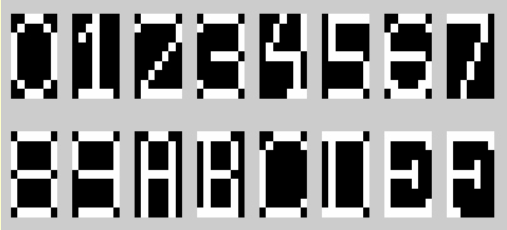
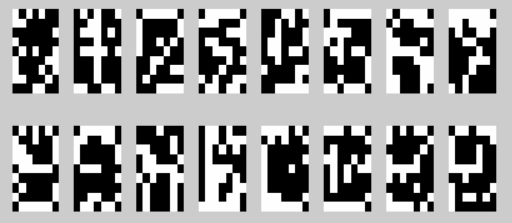
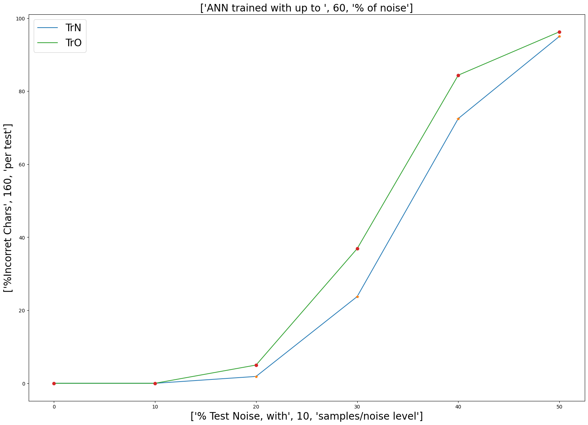

# Reconhecimento de caracteres com tolerância a ruído

Um experimento de OCR com uma rede neural multicamadas: a ideia é reconhecer caracteres mesmo quando parte dos pixels foi invertida. Comparei uma rede treinada com os padrões originais com redes que receberam níveis crescentes de ruído durante o treinamento.



Padrões apresentados no [relatório](OCR_ICIN_UnB_170072274.pdf). Cada caractere ocupa uma matriz de 9 × 7 pixels, convertida em um vetor de 63 entradas.

## Como foi feito

O trabalho foi desenvolvido em Inteligência Computacional, na Universidade de Brasília, a partir do material do professor Adolfo Bauchspiess. Usa **Python, TensorFlow/Keras, NumPy e Matplotlib**.

A rede tem 63 entradas, uma camada oculta com 30 neurônios e 16 saídas. As camadas densas usam ativação sigmoide; o treinamento usa Adam e `binary_crossentropy`.

Primeiro, a rede base aprende os 16 padrões sem ruído por 800 épocas. Depois, cada nova rede recebe os pesos da anterior e treina com amostras de 10%, 20%, 30%, 40% e 50% de ruído. Em cada etapa há dez amostras ruidosas, com dez épocas de treino por amostra, seguidas de um reforço com os padrões originais.



## O que os resultados mostram

| Ruído no teste | Erro da rede base | Erro da rede da etapa com ruído |
| --- | ---: | ---: |
| 0% | 0% | 0% |
| 10% | 0% | 0% |
| 20% | 5,00% | 1,88% |
| 30% | 36,88% | 23,75% |
| 40% | 84,38% | 72,50% |
| 50% | 96,25% | 95,00% |

Valores da execução salva nos notebooks. Cada ponto considera dez amostras dos 16 caracteres, totalizando 160 classificações. Os números podem mudar em outra execução, pois a geração de ruído e a inicialização dos pesos não têm sementes fixadas.



Com 30% de ruído, o erro caiu 13,13 pontos percentuais nessa execução. Já com metade dos pixels alterada, as duas abordagens tiveram erro alto. A figura original tem um título que menciona 60%; o código e os pontos apresentados vão de 0% a 50%.

Há uma particularidade na comparação: em cada nível, a curva com ruído usa o modelo daquela etapa (`Models[i]`), enquanto a base é sempre `Models[0]`. Ela não mostra um único modelo final sendo avaliado em todos os níveis. Esse é um bom próximo experimento.

## Escolha uma versão

| Ambiente | Arquivo | Observação |
| --- | --- | --- |
| Google Colab | [`OCR_ICIN_UnB_Colab/OCR_ICIN_UnB (1).ipynb`](OCR_ICIN_UnB_Colab/OCR_ICIN_UnB%20%281%29.ipynb) | A primeira célula cria `geraChar.py` no ambiente |
| Jupyter / VS Code | [`OCR_ICIN_UnB_VScode/OCR_ICIN_UnB.ipynb`](OCR_ICIN_UnB_VScode/OCR_ICIN_UnB.ipynb) | Usa o `geraChar.py` da mesma pasta |

Para executar localmente, no PowerShell:

```powershell
git clone https://github.com/WmsTech/Redes-Neurais---MLP.git
cd Redes-Neurais---MLP
python -m venv .venv
.\.venv\Scripts\python -m pip install tensorflow numpy matplotlib notebook
.\.venv\Scripts\python -m notebook
```

Execute as células na ordem, com o kernel na pasta da versão escolhida. A célula que desenha a arquitetura com `plot_model` depende também de pydot e Graphviz; ela pode ser pulada para seguir com o treinamento e a validação. O Colab é uma alternativa para evitar a configuração local do TensorFlow.

## Documentação

- [Relatório de Washington Marinho dos Santos](OCR_ICIN_UnB_170072274.pdf): estratégia de treinamento e análise dos resultados.
- [Roteiro do exercício](OCR_IC_UnB.pdf): proposta e critérios de avaliação da disciplina.

O material didático de base é de Adolfo Bauchspiess; o relatório e os experimentos apresentados são de Washington Marinho dos Santos. Este é um estudo com padrões binários gerados para a atividade, sem avaliação sobre fotografias ou documentos reais.
